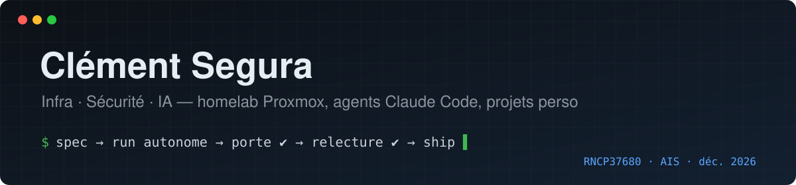
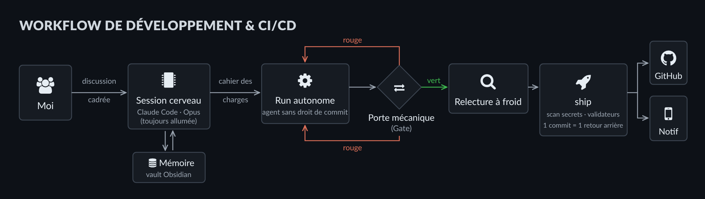
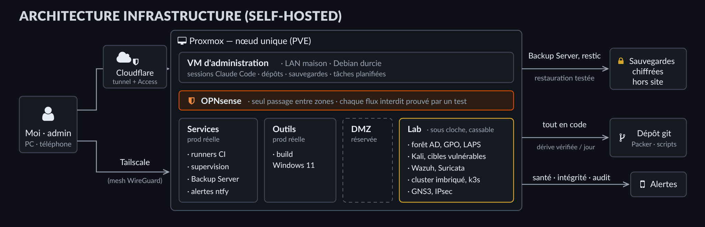

**En reconversion vers l'administration d'infrastructures sécurisées** — titre pro RNCP37680, formation à partir de décembre 2026.
L'IA est au centre de ma façon de travailler : je monte avec elle ce qui doit tourner, puis je le décortique jusqu'à savoir expliquer chaque brique.

---

### 🤖 Mon atelier IA

Une session Claude Code tourne en permanence sur mon serveur. Je la pilote depuis le PC ou le téléphone, elle écrit les cahiers des charges avec moi, lance des agents autonomes, relit leur travail et publie.

- **Agents encadrés** — une run autonome ne peut ni committer ni se déclarer « finie » si la porte de tests est rouge ; kill-switch, une run à la fois
- **Un humain au bon endroit** — rien ne part sans mon « go » ; la publication suit une politique écrite par projet
- **Mémoire longue** — vault Obsidian synchronisé sur mes appareils, lu par un sous-agent léger pour ne pas saturer le contexte
- **Garde-fous automatiques** — hooks : scan de secrets, plan écrit obligatoire avant de toucher la sécurité ou les migrations
- **Bon modèle au bon poste** — le plus petit modèle qui ne fera pas recommencer : gros modèle pour le jugement, petit pour l'extraction
- **Boucles autonomes bridées** — une veille IA hebdomadaire tourne seule : lecture web uniquement, écrit dans le vault, modèle économique, kill-switch
- **Bibliothèque** — 110+ fiches de lecture et synthèses de recherche, ingérées depuis des PDF, consultables par les agents
- **Poste de travail** — PC Windows double écran, VM Windows 11 pilotée depuis le serveur pour tester les builds, session principale joignable depuis le téléphone

### 🧱 Le homelab

- **Zones cloisonnées** — un pare-feu OPNsense en VM est le seul passage vers quatre zones (services, outils, DMZ, lab) ; chaque flux interdit est prouvé par un test qui doit échouer
- **Prod réelle, lab sous cloche** — la prod ne sert que de vrais besoins et ne se casse jamais : pour l'abîmer, on la clone au lab
- **Aucune redirection de port** — administration par Cloudflare Tunnel + Access (code à usage unique) et Tailscale (mesh WireGuard) entre PC, téléphone et serveurs
- **Sauvegardes vérifiées, pas supposées** — Proxmox Backup Server sur disques dédiés, copies chiffrées hors site ; restic avec test de restauration automatique
- **Supervision** — Prometheus, Alertmanager, Grafana, Loki ; alertes sur téléphone par un serveur ntfy auto-hébergé
- **Tout en code** — modèles de VM Packer, scripts versionnés, contrôle quotidien de dérive entre l'infra réelle et le dépôt
- **Secrets hors du code** — chiffrés (sops), et chaque commit passe un détecteur de secrets
- **Procédures de reprise écrites** — et déjà utilisées sur incident réel

**Le lab — `socle`**, monté par agents et décortiqué brique par brique :

- **Identité Windows** — forêt AD à deux contrôleurs, DHCP en basculement, GPO, LAPS, AD CS, WSUS, déploiement de logiciels, GLPI authentifié par l'AD
- **Réseau et sécurité** — GNS3, second pare-feu relié en IPsec, Suricata en IPS, bastion Guacamole
- **Attaque et détection** — Kali, cibles vulnérables (DVWA, Metasploitable), AD volontairement faillible, scans Greenbone, Wazuh
- **Virtualisation et conteneurs** — cluster Proxmox imbriqué (HA, Ceph), Docker Swarm, k3s
- **Cloud** — stockage S3 local (Garage), Terraform
- **Recette** — tout reconstruire depuis zéro, une commande par brique (en cours)

### 🛡️ Sécurité

**Sur le serveur**

- SSH par clé uniquement, port non standard · fail2ban · pare-feu ufw · mises à jour de sécurité automatiques
- **auditd**, **AIDE** (intégrité des fichiers, contrôle hebdo) et **Lynis** (audit système hebdo) — alertes sur téléphone
- **Bac à sable** pour tout code tiers : système de fichiers isolé, sorties réseau sur liste blanche

**Dans les applications** (AcademIA)

- Sessions opaques Redis + CSRF, mots de passe Argon2id, CSP en mode bloquant, MFA TOTP (secret chiffré au repos)
- LLM : nettoyage des données personnelles, isolation entre utilisateurs, limites de débit et de coût
- Cloudflare : WAF, HSTS, DMARC · dépendances surveillées (Dependabot + audit en CI)
- **RGPD** : analyse d'impact, registre des traitements, endpoints de demande d'accès et d'effacement

### 📦 Projets

<!-- vitrine:projets:debut -->
| | Projet | Ce que c'est | État |
|---|---|---|---|
| 🎮 | **ColdBoot** | Jeu de hacking narratif (Godot), façon Uplink / Hacknet — construit par agents autonomes |  |
| 🤖 | **jarvis** | Assistant personnel (mails, agenda, GitHub) : lecture seule d'abord, chaque action validée par écrit |  |
| 🧱 | **socle** | Refonte du homelab : zones cloisonnées, AD/GPO, supervision, terrain cyber |  |
| 🌐 | **webforge** | Création de sites vitrines pour artisans et commerces locaux : repérage, maquettes par métier |  |
| 🎙️ | **Greffier** | Bot Discord : enregistre une réunion à la demande, transcription locale (whisper.cpp) et synthèse |  |
| 🎓 | **Formation AIS** | Préparation du titre RNCP37680, suivi de progression maison |  |
| 🐉 | **MJIA** | Copilote IA de maître du jeu D&D 5e sur Foundry VTT auto-hébergé |  |
| 🎯 | **Tarkov Overlay** | Overlay PVE pour Escape from Tarkov : quêtes, planque, prix |  |
| 🗣️ | **AcademIA** | Apprentissage des langues piloté par LLM, pédagogie adaptative |  |
| 🏎️ | **RaceIA** | Ingénieur de course IA pour Assetto Corsa : télémétrie, analyse des virages, briefing |  |
| ✅ | **Eisenday** | App mobile de productivité (matrice d'Eisenhower), 13 langues |  |
<!-- vitrine:projets:fin -->

📈 **[Suivi détaillé des projets](SUIVI.md)** — versions, nouveautés et activité, mis à jour automatiquement chaque lundi.

### 🛠 Outils

**Infra**            

**Supervision et sécurité**     

**IA**  

**Dev**     

### 📍 Contact

`sinseproduction@gmail.com` · Nîmes (Gard) — bassin montpelliérain
