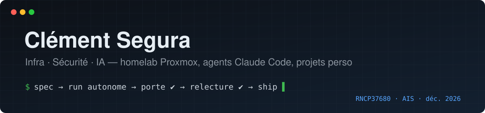
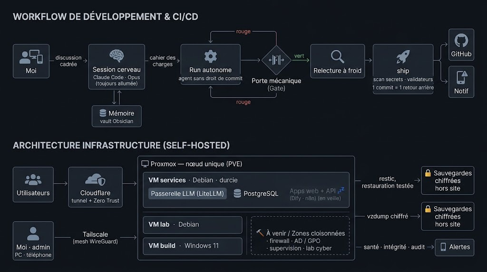
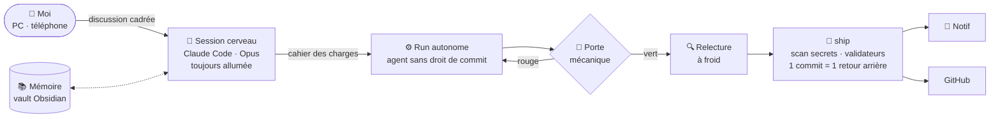
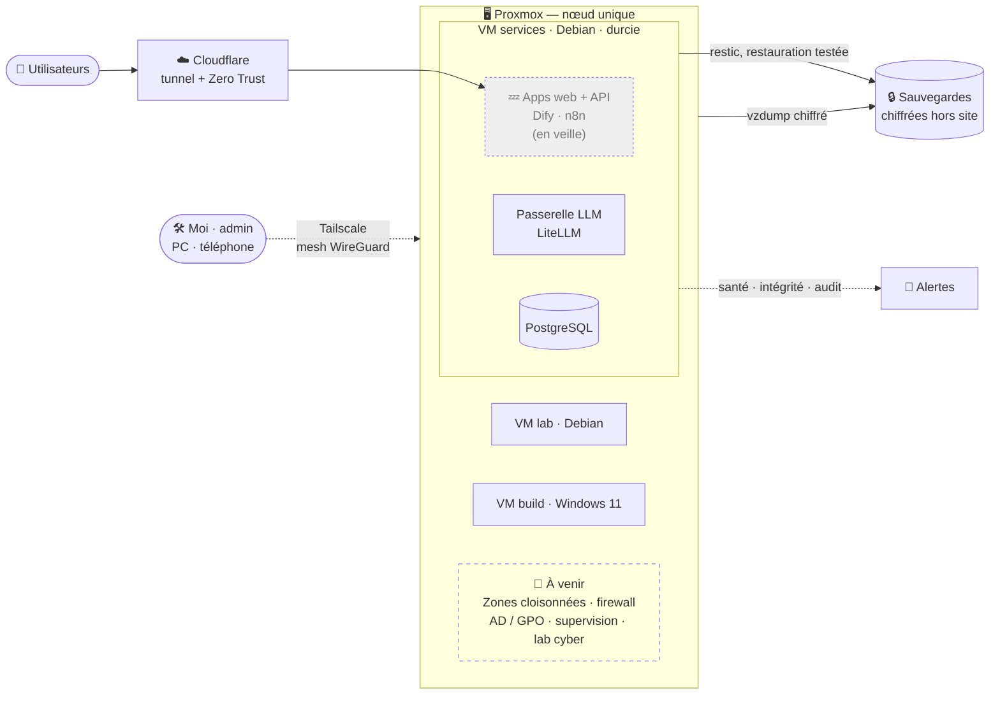

**En reconversion vers l'administration d'infrastructures sécurisées** — titre pro RNCP37680, formation à partir de décembre 2026.
L'IA est au centre de ma façon de travailler : je monte avec elle ce qui doit tourner, puis je le décortique jusqu'à savoir expliquer chaque brique.

---

### 🤖 Mon atelier IA

Une session Claude Code tourne en permanence sur mon serveur. Je la pilote depuis le PC ou le téléphone, elle écrit les cahiers des charges avec moi, lance des agents autonomes, relit leur travail et publie.

Le flux en version texte

- **Agents encadrés** — une run autonome ne peut ni committer ni se déclarer « finie » si la porte de tests est rouge ; kill-switch, une run à la fois
- **Un humain au bon endroit** — rien ne part sans mon « go » ; la publication suit une politique écrite par projet
- **Mémoire longue** — vault Obsidian synchronisé sur mes appareils, lu par un sous-agent léger pour ne pas saturer le contexte
- **Garde-fous automatiques** — hooks : scan de secrets, plan écrit obligatoire avant de toucher la sécurité ou les migrations
- **Bon modèle au bon poste** — le plus petit modèle qui ne fera pas recommencer : gros modèle pour le jugement, petit pour l'extraction
- **Boucles autonomes bridées** — une veille IA hebdomadaire tourne seule : lecture web uniquement, écrit dans le vault, modèle économique, kill-switch
- **Bibliothèque** — 110+ fiches de lecture et synthèses de recherche, ingérées depuis des PDF, consultables par les agents
- **Poste de travail** — PC Windows double écran, VM Windows 11 pilotée depuis le serveur pour tester les builds, session principale joignable depuis le téléphone
- **Passerelle LLM maison** — LiteLLM devant plusieurs fournisseurs, orchestration Dify et n8n pour les apps

### 🧱 Le homelab

Le homelab en version texte

- **Publication par tunnel sortant** — Cloudflare Tunnel + Zero Trust Access devant chaque service, pas de redirection de port
- **Administration à distance par réseau privé** — Tailscale (mesh WireGuard) entre PC, téléphone, hyperviseur et serveur
- **Sauvegardes vérifiées, pas supposées** — restic avec test de restauration automatique, copie froide, sauvegardes de VM chiffrées hors site
- **Secrets hors du code** — chiffrés (sops), et chaque commit passe un détecteur de secrets
- **Supervision** — tests de santé planifiés (timers systemd), alertes sur téléphone
- **Procédures de reprise écrites** — et déjà utilisées sur incident réel

**En construction — `socle`**, selon quatre règles : les frontières réseau sont *appliquées*, pas supposées · tout est *reconstructible*, et ça a été prouvé · on sait que c'est cassé *avant* l'utilisateur · chaque décision est écrite, le *pourquoi* plutôt que le *quoi*.
Première décision sur la table : Tailscale passe par-dessus tout cloisonnement — son statut se tranche *avant* de poser les zones, pas après.

### 🛡️ Sécurité

**Sur le serveur**
- SSH par clé uniquement, port non standard · fail2ban · pare-feu ufw · mises à jour de sécurité automatiques
- **auditd**, **AIDE** (intégrité des fichiers, contrôle hebdo) et **Lynis** (audit système hebdo) — alertes sur téléphone
- Conteneurs durcis (capabilities réduites au strict nécessaire), socket Docker derrière un proxy
- **Bac à sable** pour tout code tiers : système de fichiers isolé, sorties réseau sur liste blanche

**Dans les applications** (AcademIA)
- Sessions opaques Redis + CSRF, mots de passe Argon2id, CSP en mode bloquant, MFA TOTP (secret chiffré au repos)
- LLM : nettoyage des données personnelles, isolation entre utilisateurs, limites de débit et de coût
- Cloudflare : WAF, HSTS, DMARC · dépendances surveillées (Dependabot + audit en CI)
- **RGPD** : analyse d'impact, registre des traitements, endpoints de demande d'accès et d'effacement

### 📦 Projets

<!-- vitrine:projets:debut -->
| | Projet | Ce que c'est | État |
|---|---|---|---|
| 🧱 | **socle** | Refonte du homelab : zones cloisonnées, AD/GPO, supervision, terrain cyber |  |
| 🎓 | **Formation AIS** | Préparation du titre RNCP37680, suivi de progression maison |  |
| 🎮 | **ColdBoot** | Jeu de hacking narratif (Godot), façon Uplink / Hacknet — construit par agents autonomes |  |
| 🗣️ | **AcademIA** | Apprentissage des langues piloté par LLM, pédagogie adaptative |  |
| 🏎️ | **RaceIA** | Ingénieur de course IA pour Assetto Corsa : télémétrie, analyse des virages, briefing |  |
| 🐉 | **MJIA** | Copilote IA de maître du jeu D&D 5e sur Foundry VTT auto-hébergé |  |
| ✅ | **Eisenday** | App mobile de productivité (matrice d'Eisenhower), 13 langues |  |
<!-- vitrine:projets:fin -->

### 🛠 Outils

**Infra**         

**IA**     

**Dev**     

### 📍 Contact

`sinseproduction@gmail.com` · Nîmes (Gard) — bassin montpelliérain
