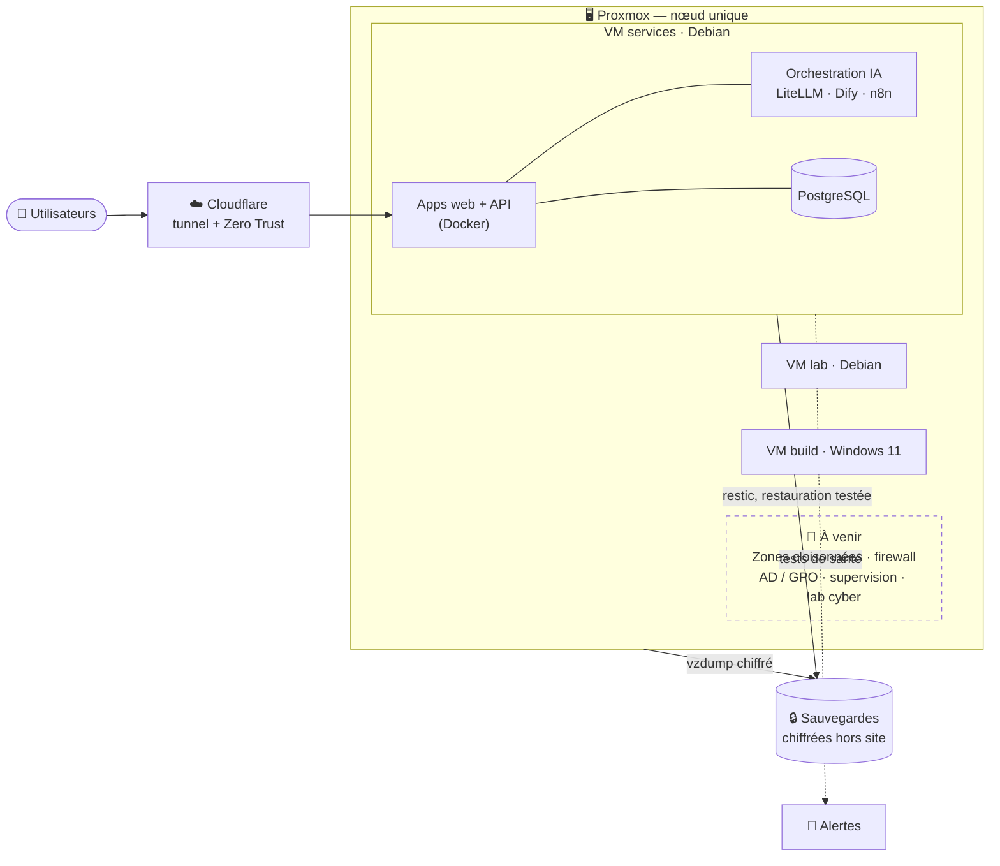

## Clément Segura

**En reconversion vers l'administration d'infrastructures sécurisées.**
Titre pro RNCP37680 (Administrateur d'Infrastructures Sécurisées) — formation à partir de décembre 2026.

J'apprends en construisant : un homelab qui tourne en vrai, documenté décision par décision.

### 🧱 Ce qui tourne aujourd'hui

Un hyperviseur Proxmox à la maison, qui porte mes services au quotidien :

- **Exposition sans port ouvert** — tunnel Cloudflare + Zero Trust Access devant chaque service
- **Sauvegardes vérifiées, pas supposées** — restic avec test de restauration automatique, copie froide, sauvegardes de VM chiffrées hors site
- **Secrets hors du code** — chiffrés (sops), et chaque commit passe un détecteur de secrets avant de partir
- **Supervision** — tests de santé planifiés (timers systemd), alertes sur téléphone
- **Procédures de reprise écrites** — et déjà utilisées sur incident réel

### 🔨 En construction — `socle`

Refonte du homelab selon quatre règles :
1. Les frontières entre zones réseau sont **appliquées**, pas supposées
2. Tout est **reconstructible**, et ça a été prouvé au moins une fois
3. On sait que c'est cassé **avant** l'utilisateur
4. Chaque décision est écrite — le *pourquoi*, pas le *quoi*

Prochaines étapes : cloisonnement réseau, VM Windows (AD, GPO), stack de supervision, terrain d'exercice cyber.

### 🎮 À côté

- **ColdBoot** — jeu de hacking narratif (Godot), dans la lignée d'Uplink / Hacknet
- **AcademIA** — plateforme d'apprentissage des langues pilotée par LLM (en pause)

### 🤖 Méthode

Je monte avec l'IA (Claude Code) l'infrastructure dont la formation a besoin, puis je la décortique :
chaque brique tourne vraiment, et je dois savoir expliquer pourquoi elle est là et comment elle tient.
Garde-fous : un commit = une unité annulable, décisions écrites (ADR), contrôles automatiques avant chaque publication.

### 📍 Contact

`sinseproduction@gmail.com` · Nîmes (Gard) — bassin montpelliérain
